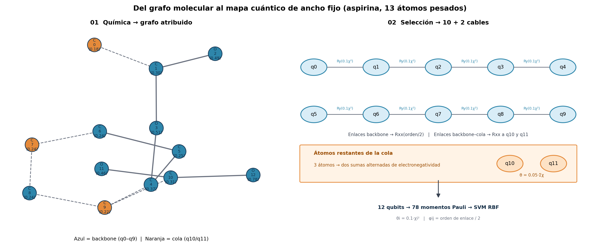
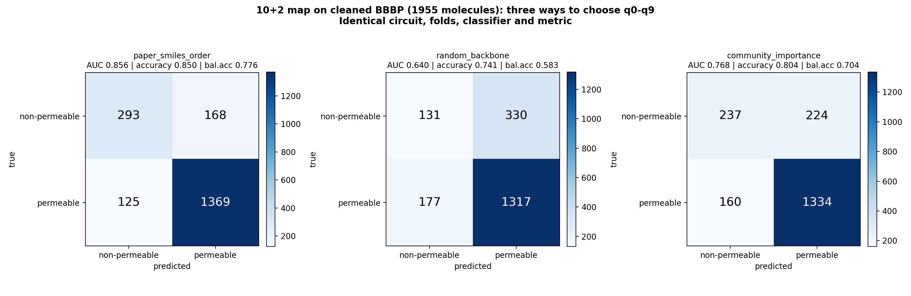
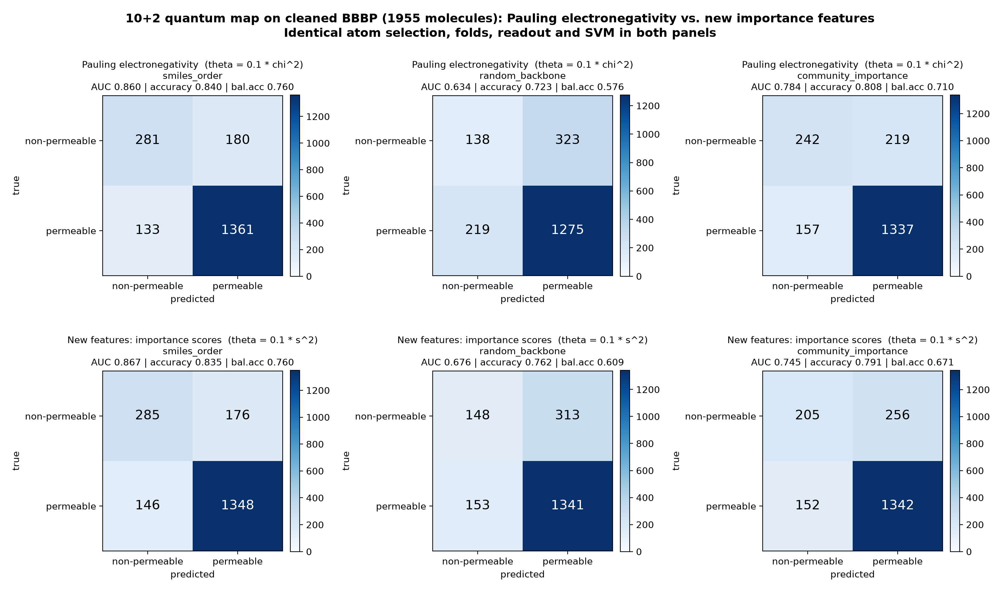

# Full BBBP + 10+2 Quantum Feature Map

Branch **`analysis_features`** – all work is in this branch.

This repository contains a clean pipeline for the BBBP dataset and a 12‑qubit quantum feature map (10 backbone + 2 tail qubits).  The README explains **what was cleaned**, **how the embedding is built**, and the **three main experiments** that compare different qubit‑selection strategies.



*Figure 1 – Heavy‑atom graph of aspirin and its conversion into the fixed‑width 10+2 circuit.  Blue nodes = backbone (q0‑q9); orange nodes = tail (q10/q11).* 

---

## 1. Dataset (cleaned)

- Source: `data/raw/BBBP.csv` – 2050 rows from DeepChem.
- Cleaning stages (see `analysis_features/verify.py`):
  - **Parse** with RDKit – 11 invalid SMILES.
  - **Remove salts/solvents** – 105 rows kept, parent molecule chosen by a deterministic rule (largest heavy‑atom fragment).
  - **Resolve label conflicts** – 11 structures with contradictory labels (e.g. propranolol) are removed.
  - **Deduplicate** – 62 duplicate structures retained by first occurrence.
  - **Final count** – 1955 unique molecules (461 non‑permeable, 1494 permeable).
- The clean CSV, audit logs, RDKit version and a timestamp are written to `data/processed/`.
- RDKit **2024.03.5**.

### Key decisions
| Decision | Description |
|---|---|
| **Charges** | Kept as‑is; no neutralisation. |
| **Tautomers** | Not merged; marked if ambiguous. |
| **Stereochemistry** | Retained; the quantum circuit is stereocontrolled‑blind. |
| **Electronegativities** | Hannan table extended with Br 2.96, I 2.66, P 2.19; missing elements raise an error. |
| **Tail size** | `atoms_beyond_10 = max(0, heavy_atom_count‑10)`; 94.7 % of molecules have a tail.

---

## 2. Methods: from molecular graph to circuit

### 2.1 Embedding construction

The 12‑qubit circuit is built as follows:

1. **Parse SMILES → RDKit molecule → heavy‑atom graph**.
2. **Select 10 backbone atoms** using one of three strategies:
   * `paper_smiles_order` – first 10 atoms in the SMILES order.
   * `random_backbone` – 10 atoms chosen uniformly at random.
   * `community_importance` – scores each heavy atom by a weighted sum of nine RDKit descriptors (see Table 1), then picks the highest‑scoring atom per community detected by `networkx.greedy_modularity_communities`.
3. **Tail atoms** (remaining heavy atoms) are compressed into two qubits (q10 and q11) by alternating the sum of their Pauling electronegativities.
4. **Apply gates**:
   * `Ry(θi)` on qubit `qi` with `θi = ALPHA * χi²` (α = 0.1, χ = electronegativity).
   * `Rxx(bond_order/2)` for each bond inside the backbone.
5. **Readouts**: 12 `<Z>` moments and 66 `<ZZ>` moments (78 features in total).
6. **Classifier**: a classical SVM with RBF kernel (`C = 10`) trained on the 78‑dimensional feature vectors.

> The circuit is a **feature map**; the SVM makes the final prediction.

### 2.2 Descriptor weights and why they have those values

The community‑importance strategy scores each heavy atom with nine descriptors. **The weights are fixed expert priors derived from the medicinal‑chemistry literature on passive BBB permeation; they are never fitted to BBBP labels**, so no test information enters the atom selection.

| Descriptor | RDKit source | Weight | Basis for the weight |
|---|---|---:|---|
| TPSA contribution | `rdMolDescriptors._CalcTPSAContribs` | 0.20 | Polar surface area is the single most used BBB filter: CNS compounds typically need PSA < 90 Ų, and reduced PSA correlates with permeation rate better than lipophilicity [1, 2, 3]. |
| LogP contribution | `rdMolDescriptors._CalcCrippenContribs` | 0.20 | Lipophilicity is the other dominant term; brain uptake follows a parabolic relationship with logP (optimum ≈ 1.5–2.7) [1, 4]. |
| H‑bond donors | `BaseFeatures.fdef` | 0.15 | Donors impose a larger desolvation penalty than acceptors and are more restrictive in CNS design [1, 5]. |
| H‑bond acceptors | `BaseFeatures.fdef` | 0.10 | Relevant but less penalising than donors; marketed CNS drugs average ≈ 2.1 acceptors vs ≈ 1.5 donors [1, 5]. |
| Molar refractivity | `_CalcCrippenContribs` | 0.10 | Size/polarizability appears as an independent term in Abraham‑type BBB equations [4, 6]. |
| Gasteiger partial charge | `AllChem.ComputeGasteigerCharges` | 0.10 | Local polarity and ionisation state govern desolvation at the membrane interface [1, 7]. |
| Formal charge | `atom.GetFormalCharge()` | 0.05 | Strong acids/bases are largely excluded from the CNS, but charges are rare here (34 structures), so a small weight prevents domination [1, 7]. |
| Heteroatom flag | `atom.GetAtomicNum() != 6` | 0.05 | Coarse proxy for hydrogen bonding and PSA; deliberately small because it is redundant with the descriptors above [1]. |
| Aromaticity | `atom.GetIsAromatic()` | 0.05 | Distinguishes aromatic N from amide N and contributes to membrane affinity; a weak tie‑breaker [1]. |

Each continuous descriptor is rescaled **within each molecule** as `|x_i − mean| / max_j |x_j − mean|`, so it lies in [0, 1] regardless of its physical unit (Ų, log units, e). Binary flags are already in {0, 1}. The weights sum to one, so the score is a dimensionless weighted average: they are *relative shares of chemical salience*, not physically comparable coefficients. Note that this score selects **which atoms are resolved by the ten qubits** — it is not a permeability prediction and it is not added to the classifier features; the SVM on the 78 Pauli moments makes the label decision.

**Are these numbers optimal? No, and we do not claim they are.** `python -m analysis_features weight-probe` re-runs the identical pipeline with equal weights and 20 random Dirichlet weight vectors: expert priors give AUC **0.7679**, equal weights **0.7697** (Δ = 0.0018), and random draws **0.7538 ± 0.0247** [0.6968, 0.7927]. The exact weights are therefore not critical; what matters is that atom selection is chemistry‑driven rather than random (0.768 vs 0.639 AUC, a gap ≈ 5× the random‑weight standard deviation). Full justification, sensitivity table and references: `results/README.md`.

[1] Pajouhesh & Lenz, *NeuroRx* 2:541–553 (2005). [2] Veber et al., *J. Med. Chem.* 45:2615–2623 (2002). [3] Hitchcock & Pennington, *J. Med. Chem.* 49:7559–7583 (2006). [4] Hansch/Leo analysis in [1]. [5] Kenny, *J. Med. Chem.* 65:14261–14275 (2022). [6] Wildman & Crippen, *J. Chem. Inf. Comput. Sci.* 39:868–873 (1999). [7] Muehlbacher et al., *J. Comput.-Aided Mol. Des.* 25:1095–1106 (2011).

### 2.3 Summary of the three experiments

| Arm | Accuracy | Balanced accuracy | AUC |
|---|---|---|---|
| `paper_smiles_order` | 0.8501 | 0.7760 | 0.8559 |
| `random_backbone` | 0.7407 | 0.5828 | 0.6399 |
| `community_importance` | 0.8036 | 0.7035 | 0.7679 |

The **confusion matrices** for each arm are shown in a single figure below (generated by `python -m analysis_features three-arms`).



*Figure 2 – Out‑of‑fold confusion matrices for the three selection strategies.*

### 2.4 Pauling electronegativity vs. the new importance features

The new embedding (`analysis_features/embedding_with_importance.py`) parameterises the ten backbone `Ry` rotations with the per‑atom BBBP importance score `s` instead of the Pauling electronegativity: `θi = 0.1·sᵢ²` rather than `0.1·χᵢ²`. Everything else is unchanged, including the alternating‑electronegativity tail, so the two panels differ only in the backbone angles. The comparison runs both maps on the same three atom‑selection rules, folds and SVM (`python -m analysis_features embedding-comparison`):

| Embedding | SMILES order | Random backbone | Community importance |
|---|---:|---:|---:|
| Pauling `χ²` | AUC 0.860 | AUC 0.634 | AUC 0.784 |
| New features `s²` | AUC 0.867 | AUC 0.676 | AUC 0.745 |



*Figure 3 – Two panels of out‑of‑fold confusion matrices: Pauling electronegativity (top) and the new importance‑based features (bottom), each for SMILES order, random backbone and community importance.*

---

## 3. Reproducibility

```bash
# Install dependencies
pip install -r requirements.txt

# Clean the raw data
python -m analysis_features clean

# Run all sanity checks
python -m analysis_features verify

# Produce the three‑arm experiment artefacts
python -m analysis_features three-arms

# Compare Pauling vs new importance features (2x3 confusion matrices)
python -m analysis_features embedding-comparison

# Draw the graph‑to‑circuit diagram
python -m analysis_features diagram

# Sensitivity analysis of descriptor weights
python -m analysis_features weight-probe

# Run the test suite
pytest
```

All commands are idempotent – running them again produces the same outputs (CSV, JSON, PNG).  The outputs live under `results/` and `data/processed/`.

---

## 4. License and citation

This work is released under the MIT license.  Please cite the original paper if you use the dataset or the code.
