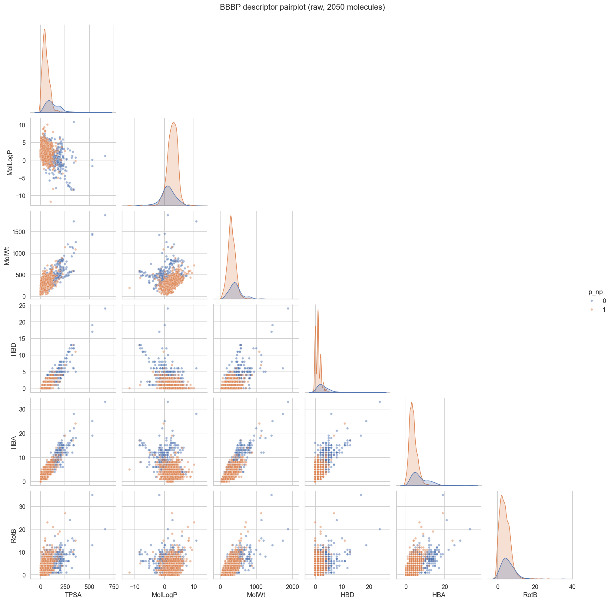
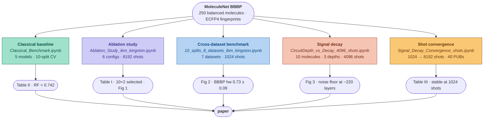

# Quantum Feature Mapping for Molecular Classification
### Evaluating Exponential Expressivity in NISQ Hardware

**Abdul Hannan · Maral Mahmoudi Kamelabad · Anna Kazakova Lindegren · Robert Loredo**

> Presented at IEEE Quantum Week 2026 (QCE26). This repository contains all experimental notebooks used to produce the results, figures, and tables in the paper.

---

## Overview

This work introduces the **10+2 Structure-Preserving Quantum Feature Map** — a fixed-width 12-qubit encoding designed for NISQ-compatible molecular classification. Ten qubits encode the molecular graph backbone via Ry rotations (Pauling electronegativity) and Rxx entangling gates (bond order), while two auxiliary qubits compress the remaining atomic tail. The original paper pipeline used the full 4,096-bin measurement distribution. In the current modular molecular-classification runners, the default SVM readout is instead 78 Pauli moments: 12 $\langle Z_i\rangle$ and 66 $\langle Z_iZ_j\rangle$, estimated jointly from the same computational-basis bitstrings. Full probabilities remain available as a diagnostic and legacy comparator.

The framework is evaluated on MoleculeNet's BBBP benchmark and six additional datasets using the **ibm_kingston** quantum processor via IBM Quantum, with 10-split stratified cross-validation throughout.

The repository also includes a modular, RDKit-based chemistry-aware strategy
for assigning atoms to the ten individually encoded backbone qubits. It greedily
maximizes marginal coverage of local Morgan environments and chemical roles,
with small graph-centrality and connectivity terms; the remaining heavy atoms
are compressed into two global tail channels. The full mathematical definition,
assumptions, and reproducibility details are in
[`molecular_encoding/README.md`](molecular_encoding/README.md).

## Full BBBP data cleaning

The full-dataset cleaning request is implemented in
[`experiments/clean_bbbp_full.py`](experiments/clean_bbbp_full.py) and runs with
`python -m experiments.clean_bbbp_full`. It processes all 2,039 source rows,
not the 250-molecule subset, and writes [`data/BBBP_clean_full.csv`](data/BBBP_clean_full.csv),
the stage-by-stage [`cleaning log`](data/BBBP_clean_log.txt), and
[`cleaning settings`](data/BBBP_clean_settings.json) (including the RDKit
version). The present run parsed all rows, stripped extra fragments from 105,
excluded 22 rows from 11 structures with conflicting labels, collapsed 62
duplicate rows, and retained 1,955 unique structures. All ten elements in the
cleaned data are covered by the Pauling table; the script fails loudly if a
new element is missing rather than silently applying its fallback value.

For example, RDKit removes the isolated chloride from propranolol before
canonicalization, so it cannot take the first backbone qubit. The parent
structure itself has contradictory labels in this source and is excluded; no
label is selected without external evidence. The cleaned CSV flags whether
each retained molecule belongs to the original 250-molecule benchmark. The
current log reports 250/250 canonical structures matched, though this flag is
about structural matching: rows that are conflicting in the full dataset are
excluded from the cleaned output. Formal charges are retained; stereo is
preserved in isomeric canonical SMILES; tautomers are not merged and possible
cross-label tautomer/stereoisomer groups are flagged. Heavy-atom count,
heavy-atom bond count, and the count beyond ten are included.


The chemistry decisions, caveats, and methods-ready wording—including why
the current circuit cannot distinguish stereoisomers and why canonical atom
ordering is preferable for reproducible chemistry-aware assignment—are in
[`docs/METHODOLOGY.md`](docs/METHODOLOGY.md#11-full-dataset-cleaning). The
cleaner intentionally keeps the source SMILES and source row for traceability.

### Full-data model diagnostics

Run `python -m experiments.run_full_dataset_diagnostics` to reproduce the
full-data, five-fold scaffold-held-out comparison and out-of-fold diagnostics.
It compares source-string order, canonical traversal, `CHEMICAL_COVERAGE`,
three randomized SMILES serializations, and a full-state fidelity quantum
kernel with precomputed SVM. Every molecule receives one test prediction;
confusion counts, per-fold train/test counts, per-molecule predictions,
settings, and figures are written to `Results/`. Figures include confusion
matrices, a PCA projection of the 78 Z/ZZ features, and source-string length/
aromatic notation versus label and held-out decision score. These plots are
descriptive, not proof of causal leakage or class separability.

Here, **canonical traversal** means: RDKit parses the molecule, writes a
canonical SMILES, reparses that string, and assigns q0–q9 to the first ten
heavy atoms in the resulting atom traversal (the remaining atoms go to the
tail summary). Thus the same molecular graph gets a reproducible traversal
regardless of the input SMILES spelling. It is still a positional “first ten”
rule: canonicalization does not rank atoms by BBB relevance, and canonical
SMILES is a deterministic serialization, not a unique chemically privileged
ordering. By contrast, source-SMILES order uses the first ten atoms of the
original input string, while `CHEMICAL_COVERAGE` selects atoms by graph
environments and roles before assigning qubits. Since the 78 Z/ZZ outputs are
indexed by qubit, these three assignments can yield different feature vectors.

Latest run: 1,955 molecules, 1,016 Bemis–Murcko groups (acyclic molecules
grouped together), 1,494 BBB-positive and 461 BBB-negative. Each outer fold
holds out roughly one fifth of molecules, with scaffolds kept separate.

| Representation | Accuracy | F1 | ROC-AUC |
|---|---:|---:|---:|
| Source SMILES order | 0.864 ± 0.027 | 0.912 ± 0.019 | 0.889 ± 0.030 |
| Canonical traversal | 0.830 ± 0.026 | 0.891 ± 0.020 | 0.810 ± 0.032 |
| Chemical coverage | 0.803 ± 0.031 | 0.874 ± 0.023 | 0.784 ± 0.039 |
| Randomized SMILES (three seeds; range) | 0.787–0.797 | 0.864–0.872 | 0.737–0.760 |
| Fidelity quantum kernel + SVM | 0.815 ± 0.029 | 0.881 ± 0.021 | 0.811 ± 0.032 |

The strong source-order score does not establish that atom order is chemically
superior: it is serialization-sensitive, and the source dataset has known
row/notation provenance patterns. The dataset is imbalanced, so inspect the
confusion matrices and per-molecule predictions alongside accuracy. This run
uses fixed `C=10` and exact NumPy statevectors; the fidelity kernel is a
classical simulation, not a hardware quantum-advantage claim.

#### Property/PCA follow-up

Run `python -m experiments.run_full_dataset_chemistry_pca` to compare Pauling,
TPSA and the existing multi-axis `multi_physchem` map against 13 RDKit
descriptors, fold-fitted PCA (2/4/8/13 PCs), and a source-string-length-only
artifact baseline. All use the same five scaffold-held-out folds and fixed
RBF-SVM `C=10`; scaling and PCA are fit inside each training fold. Results
are in `Results/chemistry_pca_summary.csv`; the held-out projection is
`Results/rdkit_descriptor_pca.png`. In this run the quantum chemistry arms do
not beat all 13 descriptors. Source string length alone has accuracy 0.783
but ROC-AUC 0.585, so length by itself does not explain the source-order AUC;
the cause may involve richer serialization/position interactions and is not
established. PCA with 8/13 components approaches the full-descriptor baseline,
while 2 PCs lose substantial AUC, so aggressive compression is not supported.
This is exploratory and needs an external validation set.

The design draws on graph message passing, which represents atoms/bonds and
aggregates molecular neighborhoods ([Gilmer et al., 2017](https://proceedings.mlr.press/v70/gilmer17a.html));
data re-uploading as a way to expand encoding frequencies
([Pérez-Salinas et al., 2020](https://quantum-journal.org/papers/q-2020-02-06-226/));
and evidence that fidelity kernels can concentrate and become poorly
discriminative ([Thanasilp et al., 2024](https://www.nature.com/articles/s41467-024-49287-w)).
Thus the fidelity kernel is a candidate representation, not a demonstrated
advantage; this repository computes it using exact classical statevector
simulation and makes no hardware-speedup claim.

An initial controlled BBBP comparison using the current 78-feature $Z_i+Z_iZ_j$
readout found that this new selector did **not** outperform selection by
source-SMILES order in the tested pipeline (mean accuracy 0.632 vs. 0.732
across ten paired splits). This is a descriptive
ablation on a balanced 250-molecule sample, not evidence of universal
superiority for SMILES order. See the method README and the saved per-split
results for the protocol and limitations.

A follow-up structural ablation adds a `CONNECTED_CORE` selector that grows the
ten-atom backbone along molecular bonds, plus a canonical-traversal control
that separates input-string invariance from source-file ordering. It kept the
backbone connected in 99.6% of the benchmark molecules but did not improve BBBP
accuracy over the traversal-dependent baseline; details and limitations are in
the method README.


---

## Repository Structure

```
.
├── molecular_encoding/
│   ├── chemistry/        # RDKit cleaning, selection, atom properties, tail
│   ├── graph/            # Attributed molecular graph and optional pooling
│   ├── quantum/          # Circuit, simulator, Zi/ZiZj readout and alternative
│   │                     #   quantum algorithms (kernel, Pauli, re-uploading)
│   ├── analysis/         # Collision, capacity, PCA and plotting tools
│   ├── results/          # Reproducible CSV results and JSON configurations
│   └── tests/            # Unit and invariance tests
├── docs/
│   ├── assets/           # README figures, including the BBBP EDA plots
│   ├── METHODOLOGY.md    # What each model sees, circuits, metrics, leakage
│   ├── DEVELOPMENT.md    # Layer structure and how to add an experiment
│   ├── QUANTUM_FEATURES.md  # How quantum features are extracted, step by step
│   ├── METRICS_AND_MODELS.md  # RF vs atom selection; Acc, F1, AUC, nested C
│   └── generate_encoding_visual.py
├── analysis/
│   ├── bbbp_feature_audit/  # Molecules, RDKit features, plots and leakage audit
│   ├── balanced_5050/       # Clean 50/50 CSVs: old versus new techniques
│   ├── mol_order/           # MOL-file version of the primitive first-atom encoding
│   ├── final_comparison/    # Master table: all feature families on the clean 50/50 set
│   └── full_dataset/        # Scaffold-held-out benchmark on all 1955 cleaned molecules
├── data/bbbp_mol/                   # raw input + 500 generated .mol files
├── data/BBBP_clean_full.csv         # 1955 cleaned structures from the raw dataset
├── BBBP_balanced_50_50.csv          # 125/125, no original row number
├── BBBP_balanced_50_50_canonical.csv  # Same, with canonical SMILES
├── experiments/          # Shared tools and reproducible benchmark entry points
│   └── legacy/           # Qiskit-dependent historical reproduction scripts
├── BBBP.csv
└── *.ipynb               # Original hardware and paper experiment notebooks
```

Start with [`molecular_encoding/README.md`](molecular_encoding/README.md) for
the method, chemistry assumptions, worked RDKit/NetworkX figure, and measured
comparisons. Run the modular tests with:

```bash
python -m pytest molecular_encoding/tests -q
```

Run an experiment from the repository root as a module, for example
`python -m experiments.run_selection_comparison`. Benchmark outputs are kept
in `molecular_encoding/results/`.

---

## Raw dataset EDA

The `BBBP.csv` file has no precomputed molecular features: only `num`, `name`,
the label `p_np` and a SMILES string. `python -m experiments.run_raw_bbbp_eda`
derives 13 RDKit descriptors from all 2039 parseable raw molecules (1560
permeable, 479 non-permeable) and writes the standard exploratory plots to
`docs/assets/bbbp_eda_*.png`.



The class imbalance is visible, and the separation is dominated by polarity:
permeable molecules concentrate at low TPSA, HBD and HBA and higher logP.
Descriptive univariate AUCs on the raw data:

| Descriptor | AUC | Descriptor | AUC |
|---|---:|---|---:|
| TPSA | 0.829 | HBA | 0.776 |
| HBD | 0.805 | MolWt | 0.707 |
| NumHeteroatoms | 0.780 | MolLogP | 0.697 |

More plots (class balance, distributions, boxplots, correlation heatmap) are
in `docs/assets/`, and the descriptor table plus settings are in
`molecular_encoding/results/bbbp_raw_*`. This is descriptive raw-data analysis
without deduplication or balancing; it is not the controlled 250-molecule
benchmark used by the experiments below.

---

## Notebooks

### 1. `Classical_Benchmark.ipynb`
**Corresponds to:** Table II — *Classical Baseline Comparison*

Establishes the classical performance ceiling on 250 balanced BBBP molecules (125 permeable, 125 non-permeable). Uses 256-bit radius-2 Morgan Fingerprints (ECFP4) as features. Evaluates five classifiers across 10-split stratified shuffle-split cross-validation.

| Model | Accuracy | AUC-ROC |
|---|---|---|
| Random Forest | 0.742 ± 0.052 | 0.801 ± 0.056 |
| SVM (RBF Kernel) | 0.710 ± 0.043 | 0.797 ± 0.048 |
| Gradient Boosting | 0.692 ± 0.063 | 0.748 ± 0.067 |
| Logistic Regression | 0.692 ± 0.053 | 0.760 ± 0.033 |
| SVM (Linear) | 0.682 ± 0.045 | 0.740 ± 0.037 |

Random Forest is adopted as the primary classical baseline throughout the paper.

---

### 2. `Ablation_Study_ibm_kingston[8192_shots].ipynb`:Table I — *Hardware Ablation Configuration vs. Accuracy* and Section IV-B — *Primary Classification Performance*

Both notebooks are identical runs of the same ablation experiment (the Copy is a verified duplicate confirming reproducibility). Each cell tests one of six Ncore+Mtail qubit configurations on ibm_kingston at 8,192 shots across 10 splits on the BBBP dataset.

| Configuration | Total Qubits | Hardware Accuracy |
|---|---|---|
| 8+2 | 10 | 0.76 ± 0.07 |
| 8+4 | 12 | 0.71 ± 0.07 |
| **10+2** | **12** | **0.75 ± 0.07** |
| 10+4 | 14 | 0.71 ± 0.05 |
| 12+2 | 14 | 0.74 ± 0.08 |
| 12+4 | 16 | 0.67 ± 0.05 |

The **10+2 configuration** is selected as the primary architecture for its optimal balance of structural fidelity and coherence budget.

---

### 3. `10_splits_7_datasets_experiment_ibm_kingston.ipynb`
**Corresponds to:** Figure 2 — *Cross-Dataset Accuracy Benchmark* and Section IV-C

Benchmarks the 10+2 quantum feature map against Classical RF and the noiseless simulator across **seven MoleculeNet datasets** (BBBP, Tox21, BACE, HIV, ESOL, Lipophilicity, FreeSolv) using 1,024 shots on ibm_kingston. Each dataset uses the same balanced 250-molecule protocol.

Key results (Quantum Hardware vs. Classical RF accuracy):

| Dataset | Hardware | Classical RF |
|---|---|---|
| BBBP | 0.73 ± 0.09 | 0.71 ± 0.05 |
| Tox21 | 0.58 ± 0.10 | 0.64 ± 0.06 |
| BACE | 0.62 ± 0.08 | 0.80 ± 0.07 |
| HIV | 0.52 ± 0.06 | 0.58 ± 0.06 |
| ESOL | 0.67 ± 0.05 | 0.76 ± 0.05 |
| Lipophilicity | 0.56 ± 0.08 | 0.58 ± 0.06 |
| FreeSolv | 0.61 ± 0.07 | 0.80 ± 0.04 |

---

### 4. `CircuitDepth_vs_Decay_4096_shots.ipynb`
**Corresponds to:** Figure 3 — *Circuit Depth vs. Peak Basis State Probability* and Section IV-E

Measures signal fidelity (peak basis state probability) for 10 diverse molecules across three transpiled circuit depth configurations — Shallow (~5 layers), Normal/10+2 (~105 layers), and Deep (~220 layers) — using 4,096 shots on ibm_kingston in a single batch job.

Key findings:
- At ~105 layers, all molecules remain measurably above the theoretical noise floor (1/2¹² ≈ 0.0002), ranging from **0.009** (Caffeine) to **0.298** (Benzene)
- At ~220 layers, most molecules collapse to near-noise-floor, with Urea (**0.139**) and Glycerol (**0.044**) as notable exceptions

---

### 5. `Signal_Decay&Convergence_shots[1024,_2048,_4096,_8192].ipynb`
**Corresponds to:** Table III — *Measurement Convergence: Max State Probability vs. Shot Budget* and Section IV-F

Sweeps shot budgets from 1,024 to 8,192 on the same 10 molecules using the 10+2 circuit on ibm_kingston (single batch of 40 PUBs), producing the convergence matrix showing that signal fidelity stabilizes at 1,024 shots.

| Molecule | 1024 | 2048 | 4096 | 8192 |
|---|---|---|---|---|
| Benzene | 0.3408 | 0.3257 | 0.3313 | 0.3296 |
| Urea | 0.2002 | 0.1919 | 0.1882 | 0.1958 |
| Glycerol | 0.1104 | 0.1201 | 0.1101 | 0.1185 |
| Caffeine | 0.0098 | 0.0112 | 0.0071 | 0.0066 |

---

## Experiment Map
 

 
---
 

## Hardware & Software

**Quantum Hardware:** IBM Quantum ibm_kingston (Heron r2 processor)
Additional backends used for primary classification comparison: ibm_fez, ibm_marrakesh

**Key Dependencies:**
```
qiskit >= 2.3.1
qiskit-ibm-runtime >= 0.45.1
qiskit-aer >= 0.17.2
qiskit-algorithms == 0.4.0
rdkit
scikit-learn
pandas
numpy
matplotlib
seaborn
```

Install all dependencies:
```bash
pip install qiskit qiskit-ibm-runtime qiskit-algorithms qiskit-aer pylatexenc
pip install pandas scikit-learn matplotlib seaborn rdkit
```

**IBM Quantum Access:** Notebooks require a valid IBM Quantum account. Results from hardware jobs are already stored in notebook outputs and can be inspected without re-running. To re-run hardware jobs, set your credentials via `QiskitRuntimeService.save_account(...)`.

---

## Reproducibility Notes

- All hardware experiments were run as independent job submissions on ibm_kingston. Run-to-run variance is expected on NISQ hardware and is reflected in the confidence intervals reported throughout the paper.
- The two ablation notebooks (`Ablation_Study` and `Copy_of_Ablation_Study`) are duplicate runs of the same experiment, confirming reproducibility across independent executions.
- The `Classical_Benchmark.ipynb` is fully reproducible locally without any quantum hardware access.
- All datasets are sourced from MoleculeNet via the DeepChem S3 bucket and balanced to exactly 250 molecules (125 per class) via random undersampling with `random_state=42`.

---

## Citation

If you use this code or results in your work, please cite.


---

## Acknowledgements

The authors thank the QAMP 2025 organizers and IBM Quantum for providing access to quantum hardware.
