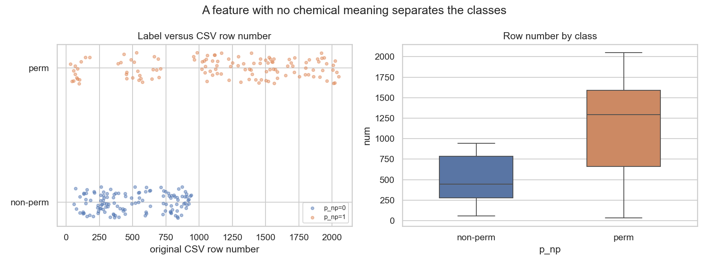
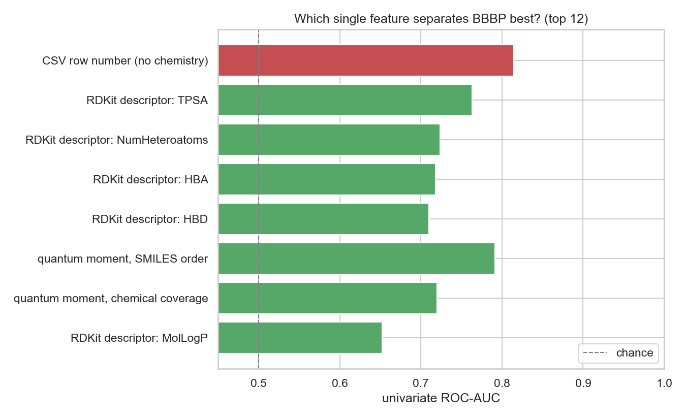

# BBBP feature audit

Self-contained audit of the 250 balanced BBBP molecules used throughout the
benchmark. Every table and figure here is regenerated by:

```bash
python -m experiments.run_bbbp_feature_audit
```

## Question

The historical "native order" control scores better than any chemistry-aware
selector or RDKit descriptor set. Is that because it reads chemistry better,
or because the source CSV carries non-chemical information?

## Contents

| Path | Contents |
|---|---|
| `tables/molecules_features.csv` | The 250 molecules: `num`, `name`, `p_np`, SMILES and 13 RDKit descriptors |
| `tables/feature_auc.csv` | Univariate ROC-AUC of every candidate feature |
| `tables/model_comparison.csv` | Fixed-C SVM scores per feature on the same ten folds |
| `tables/descriptors_by_class.csv` | Mean and standard deviation of each descriptor by class |
| `figures/row_number_leakage.png` | Label versus original CSV row number |
| `figures/feature_auc_ranking.png` | Top single features by AUC |
| `figures/model_comparison.png` | Accuracy and AUC per feature family |
| `figures/rdkit_confusion_matrix.png` | Random forest on RDKit descriptors, one held-out fold |

## Result



The original CSV row number (`num`) has **AUC 0.814** on these 250 molecules
and 0.914 in the full ten-fold classifier comparison — higher than the 78
quantum moments from SMILES order (0.815) and far higher than the 13 RDKit
descriptors (0.738) or the chemistry-aware quantum map (0.697). The same
molecules shuffled sit at chance (AUC 0.46).



`num` has no chemical meaning: the BBBP file is ordered, so permeable
molecules cluster toward higher row numbers. The SMILES-order quantum arm
partly inherits that provenance signal because the strings and the file order
come from the same curation process. A model with access to the source file
order is therefore not learning BBBP chemistry, and its higher score must not
be presented as a predictive advantage.

The best defensible chemistry-only model here is the random forest on the 13
RDKit descriptors (mean AUC 0.742 with nested C). For a real performance
claim, validate with scaffold-held-out folds as well.
