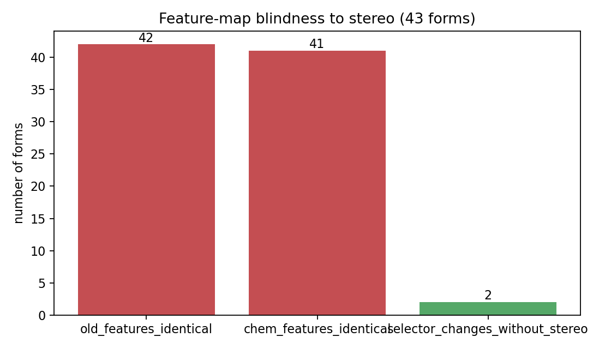

# Stereochemistry audit — does the circuit see enantiomers?

Generated by `python -m experiments.audit_stereo_collisions`.

**Short answer: RDKit does keep the stereoisomers, but the circuit cannot
distinguish them.** RDKit's canonical isomeric SMILES retains the `@/@@` tags
(629 molecules in the cleaned dataset have stereo). The feature map, however,
encodes Pauling electronegativity per atom and bond order per edge; both are
unchanged by a chiral inversion. The 3D geometry is never an input.

| Measurement | Count |
|---|---:|
| Stereoisomer forms analysed (skeletons with >1 form) | 43 |
| Forms with identical features under SMILES_ORDER + Pauling | **42 / 43** |
| Forms with identical features under CHEMICAL_COVERAGE + TPSA | **41 / 43** |
| Forms whose chemical selector changes when stereo is stripped | 2 / 43 |
| Forms in skeletons carrying opposite labels | **6** |

The single pair that differs under both maps is a cis/trans case where
canonicalization without stereo also reorders the heavy atoms, so the qubit
coordinates change. That is an accidental atom-ordering effect, not the circuit
reading chirality.

## What this means for the paper

1. The "canonical SMILES with stereo" column is **chemically correct**: we are
   not throwing away stereoisomers. But the quantum feature vector is
   *stereo-blind*; two enantiomers give the same 78 numbers.
2. Six forms belong to skeletons with contradictory labels. For those, two
   molecules with the same feature vector have different `p_np`. No classifier
   on top of the map can resolve them; they are flagged in
   `data/BBBP_clean_full.csv` (`stereo_label_conflict`) and should be excluded
   or reported as an explicit limitation in the main experiment.
3. If stereochemistry matters for BBB permeation, the encoding needs a new
   channel — e.g. a local rotated observable for chiral centers or a graph
   invariant that encodes tetrahedral parity. Without that, any claim of
   structure-based classification is incomplete.

## Files

- `tables/stereo_collisions.csv` — one row per form with the identity flags.
- `figures/stereo_collisions.png` — the three counts above.
- `settings.json` — the summary counts.
