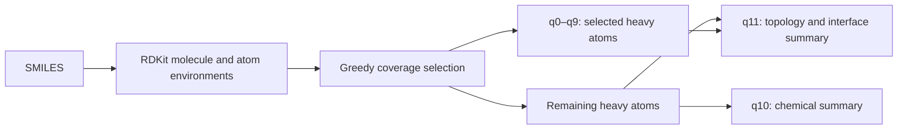

# molecular_encoding
### Chemically Grounded Quantum Feature Mapping for Molecular Classification

A self-contained Python module designed for the **QAMP 2027** follow-up study to evaluate exponential expressivity and representation bias in the 10+2 Quantum Feature Map on NISQ hardware.

---

## 1. Core Mathematical and Chemical Concepts

### 1.1 Chemistry-aware 10-atom backbone selection

The default strategy is `Strategy.CHEMICAL_COVERAGE`, implemented in
`backbone_selection.py`. It combines RDKit Morgan atom environments at radii
0, 1, and 2 (including stereochemistry and bond types); donor/acceptor feature roles; formal charge; aromaticity; ring
membership; graph centrality; and connectivity. A deterministic greedy
marginal-coverage procedure selects at most ten heavy atoms. Canonical ranks
only resolve exact score ties; they are not interpreted as atom importance.

The weights are fixed, transparent, and not fitted to BBBP labels. This makes
the default task-agnostic, but does not establish that it is chemically optimal
for every endpoint. Task-specific weights must be evaluated on held-out splits.
For symmetry-equivalent atoms, a unique chemical identity may not exist;
canonical tie-breaking supplies a reproducible representative.

#### Methodological description

Let a sanitized molecule be a heavy-atom graph $G=(V,E)$, with $|V|=N$.
For every atom $i$, define a token set $T_i$ consisting of (i) its radius-0,
radius-1, and radius-2 Morgan environments, with bond types and stereochemistry,
and (ii) the chemical-role indicators charge, hydrogen-bond donor, acceptor,
heteroatom, aromatic atom, and ring atom. The implementation uses RDKit's
standard chemical feature definitions for donor/acceptor perception. Morgan
environments are sparse identifiers associated with their central atom, so
distinct local environments are not merged by a fixed-length fingerprint.

The selector grows a set $S$ greedily, starting from $S_0=\varnothing$. At
iteration $t$, the marginal score for an unselected atom is

$$
J(i\mid S_t)=\sum_{u\in T_i\setminus C(S_t)} w(u)
              +0.15\,\widetilde C_i
              +0.20\,\frac{|N(i)\cap S_t|}{\max(1,\deg(i))},
$$

where $C(S_t)=\bigcup_{j\in S_t}T_j$ is the set of already covered tokens,
$\widetilde C_i$ is normalized graph centrality, and $N(i)$ is the heavy-atom
neighborhood. The standalone selector falls back to degree centrality when no
values are supplied; the public `assign_qubits` path supplies NetworkX
betweenness centrality.
For a Morgan token occurring $f(u)$ times in the molecule,
$w(u)=f(u)^{-1/2}$, which reduces the marginal value of repeated environments.
Role-token weights are fixed as follows: formal charge 3.0, donor 2.5,
acceptor 2.0, heteroatom 1.25, aromaticity 0.75, and ring membership 0.50.
At each step the atom maximizing $J$ is added and its tokens become covered;
the procedure stops after $\min(10,N)$ atoms. Exact score ties are broken by
RDKit canonical atom rank. Ranks therefore make the selection reproducible,
but do not enter the chemical score. See the [RDKit Morgan fingerprint
documentation](https://www.rdkit.org/docs/GettingStartedInPython.html#morgan-fingerprints)
for the underlying circular-environment construction.

This is a deterministic, label-free heuristic—not an optimality guarantee or
a claim that the selected atoms are universally the most predictive. The
coverage term rewards chemical diversity, while the small graph terms retain
central and connected context. It is permutation-independent after canonical
SMILES reparsing, except for the unavoidable representative choice among
symmetry-equivalent atoms. The ten-atom limit is an architectural bottleneck:
all remaining heavy atoms are compressed into two scalar tail channels and
some atom-level detail is lost. Consequently, selection quality must be
evaluated together with classification and information-retention diagnostics.

#### Controlled comparison against source-SMILES order

To isolate the effect of atom assignment, `run_selection_comparison.py`
compares `SMILES_ORDER` (the ten atoms encountered first in the input SMILES)
and `CHEMICAL_COVERAGE` on the same 250 balanced BBBP molecules, canonical
structure deduplication, ten stratified 75/25 splits, SVC with an RBF kernel
($C=10$), standardization fitted within each training split, and the same
global two-channel tail encoding. The quantum feature map is exactly evolved
as a 12-qubit statevector and read out as all 4,096 computational-basis
probabilities. This controlled ablation changes only the backbone-selection
strategy; it does not reproduce the older tail encoding or hardware noise.

| Backbone selection | Accuracy | F1 | ROC-AUC |
|---|---:|---:|---:|
| Source-SMILES order | 0.781 ± 0.053 | 0.772 ± 0.060 | 0.844 ± 0.043 |
| Chemical coverage | 0.678 ± 0.053 | 0.657 ± 0.063 | 0.730 ± 0.053 |
| Paired difference (coverage − SMILES) | −0.103 ± 0.076 | −0.115 ± 0.084 | −0.115 ± 0.066 |

Values are mean ± sample standard deviation across the ten repeated splits;
chemical coverage won on 0/10 splits for each metric. These results do **not**
support the claim that this selector improves BBBP prediction in the current
pipeline. They motivate further ablations (including the fixed weights, tail
features, and representation/readout), not a post-hoc change of weights based
on the reported test splits. The balanced 250-molecule subset is a small
benchmark sample, and repeated shuffle-splits are correlated; these summary
statistics are descriptive rather than a formal significance test. Exact
per-split results and settings are saved in
`selection_vs_smiles_per_split.csv`, `selection_vs_smiles_summary.csv`, and
`selection_vs_smiles_settings.json`. Reproduce from the repository root with
`python run_selection_comparison.py`.

The comparison uses NumPy exact statevector evolution of the circuit's $Ry$
and $Rxx$ gates because Qiskit could not be imported in the execution
environment. It follows their Qiskit matrix conventions, but a direct
cross-check against Qiskit's `Statevector` should be run when a working Qiskit
installation is available.

```python
from molecular_encoding import encode_molecule
from molecular_encoding.atom_selection import Strategy, assign_qubits, describe_assignment

assignment = assign_qubits("CC(=O)Nc1ccccc1", strategy=Strategy.CHEMICAL_COVERAGE)
print(describe_assignment(assignment))  # Includes per-qubit selection rationale.
qc, metadata = encode_molecule("CC(=O)Nc1ccccc1")
```

`CANONICAL_RANK`, `PHARMACOPHORE_FIRST`, `SCAFFOLD_CENTRALITY`, `SMILES_ORDER`,
and `RANDOM` remain available as baselines and controls. Selection is performed
on heavy atoms; implicit or explicit hydrogens are represented through RDKit's
features of their bonded heavy atoms.



### 1.2 Two general tail channels

All unselected heavy atoms form a single tail set; atoms are no longer
alternated between two arbitrary groups in the recommended `global` mode.
`q10` receives a bounded chemical/composition summary combining tail size and
the fractions of heteroatoms, charged atoms, donors, and acceptors. `q11`
receives a bounded topology summary combining internal tail bonds and bonds
crossing the backbone–tail boundary. Backbone–tail Rxx gates connect to `q11`.
Individual tail–tail bonds are summarized instead of encoded one by one, so
this remains a deliberately lossy representation for large tails.

The `sum`, `stats`, and `pharm` modes remain available for baseline comparison.

---

### 1.3 Bemis-Murcko Molecular Scaffold & Betweenness Centrality (Baseline Controls)

#### Bemis-Murcko Scaffold:
Decomposes drug molecules into cyclic ring systems, linkers, and side chains (**Bemis & Murcko, J. Med. Chem. 1996**). Available as `Strategy.SCAFFOLD_CENTRALITY`. While chemically intuitive, it discards polar substituents on acyclic chains and suffers from carbon-angle degeneracy in unsubstituted rings.

#### Betweenness Centrality:
Quantifies the fraction of topological shortest paths passing through atom $v$:
$$C_B(v) = \sum_{s \neq v \neq t \in V} \frac{\sigma_{st}(v)}{\sigma_{st}}$$
Used to identify bridgehead atoms connecting molecular subgraphs.

---

### 1.4 Readout: Computational Basis Probabilities vs. Pauli Expectations

* **Current Baseline Readout:** Full measurement in the computational basis ($Z$) with `qc.measure_all()` producing a 4,096-dimensional probability distribution $\vec{p} \in \mathbb{R}^{4096}$.
* **Proposed EstimatorV2 Readout (Work with Abdul):** Measuring single-qubit Pauli expectations $\langle Z_i \rangle \in \mathbb{R}^{12}$ and two-qubit correlators $\langle Z_i Z_j \rangle \in \mathbb{R}^{66}$ to drastically eliminate finite shot-noise sparsity.

### 1.5 What the literature suggests improving — and what is actually implemented

The earlier implementation and the new experiment are **different encodings**.
The original default continues to select ten individual atoms and uses one
scalar `Ry` per atom plus bond-order `Rxx` gates and a two-scalar tail. The
literature-motivated alternative is now implemented as an opt-in prototype in
`graph_pooling.py`; it does not replace the default `encode_molecule` path.

| Component | Existing default | New experimental `GRAPH_POOLED` map |
|---|---|---|
| Meaning of `q0–q9` | Up to ten individually selected heavy atoms | Up to ten connected clusters/supernodes; all heavy atoms belong to a cluster |
| Atom encoding | One `Ry` per atom; by default angle $0.1\chi_i^2$ | Pooled cluster descriptors: element family, charge, donor/acceptor, aromatic/ring fractions, TPSA/logP, stereochemistry, cluster size, internal-bond density; projected to two blocks of non-commuting `RX/RY/RZ` rotations |
| Bond encoding | One `Rxx` per represented bond with angle `bond_order/2` | Quotient-graph edges aggregate bond order and aromatic/conjugated/ring character; encoded with `RXX` and `RZZ` |
| `q10–q11` | Chemical and structural summaries of atoms outside the backbone | Whole-molecule chemical and topological context (size, polarity, HBD/HBA, edge/ring/cycle counts and pooled boundary fraction); these are context channels, not a residual-atom tail |
| SMILES traversal | Canonical atom selection, but labeled qubit coordinates remain part of the feature vector | Canonical graph construction; exact gate sequences were unchanged in 1,000 randomized-SMILES checks on the benchmark sample |

This direction follows the molecular-graph literature's use of **atom and
bond attributes with permutation-invariant aggregation**, rather than relying
on a single scalar per atom ([Gilmer et al., 2017](https://proceedings.mlr.press/v70/gilmer17a.html)).
For a fixed 12-qubit budget, the prototype lets each backbone wire represent a
chemically connected pooled fragment, rather than using one atom as a proxy
for a local environment. Molecular pooling methods such as
[MESPool](https://pmc.ncbi.nlm.nih.gov/articles/PMC10753536/) motivate
preserving connected chemical substructures during compression. The cluster
merge rule is still a hand-designed, label-free heuristic; it is not MESPool
and is not a learned pooling method.

On the quantum side, [QMSE](https://arxiv.org/abs/2507.20422) encodes molecular
bond orders and interatomic couplings as one- and two-qubit rotations, while
[quantum graph feature maps](https://arxiv.org/abs/2211.16337) demonstrate
graph-structured quantum embeddings on a molecular toxicity task. These works
motivate making edges and graph structure first-class inputs; they do not show
that their circuits will outperform this 10+2 BBBP setup. Repeating data
encoding between shallow processing layers is another principled candidate:
[Pérez-Salinas et al.](https://doi.org/10.22331/q-2020-02-06-226) study data
re-uploading, and [Schuld et al.](https://doi.org/10.1103/PhysRevA.103.032430)
show that the encoding gates determine the accessible function frequencies.
More depth is not automatically better: expressive embeddings, entanglement,
global measurements, and noise can concentrate quantum kernels and make them
harder to estimate ([Thanasilp et al., 2024](https://doi.org/10.1038/s41467-024-49287-w)).

#### Prototype design and current performance

The prototype was evaluated on the same balanced 250-molecule BBBP sample,
ten stratified 75/25 splits, 4,096 exact statevector probabilities, and
`StandardScaler + RBF-SVC (C=10)`. We also selected `C` from
`{0.1, 1, 10, 100, 1000}` using three-fold CV **inside each outer training
fold**. The atom-selected TPSA comparator uses the best existing property from
the earlier ablation.

| Representation | Accuracy | F1 | ROC-AUC |
|---|---:|---:|---:|
| Source-SMILES order, fixed $C=10$ | 0.781 ± 0.053 | 0.772 ± 0.060 | 0.844 ± 0.043 |
| `CHEMICAL_COVERAGE` + `tpsa_contrib`, fixed $C=10$ | 0.706 ± 0.058 | 0.678 ± 0.069 | 0.727 ± 0.063 |
| `GRAPH_POOLED`, fixed $C=10$ | 0.510 ± 0.048 | 0.444 ± 0.058 | 0.536 ± 0.060 |
| Source-SMILES order, nested $C$ | 0.781 ± 0.034 | 0.771 ± 0.044 | 0.873 ± 0.038 |
| `CHEMICAL_COVERAGE` + TPSA, nested $C$ | 0.703 ± 0.061 | 0.674 ± 0.065 | 0.750 ± 0.076 |
| `GRAPH_POOLED`, nested $C$ | 0.486 ± 0.037 | 0.403 ± 0.244 | 0.530 ± 0.058 |

This first graph-pooling design **does not improve BBBP prediction**; it is
near chance and remains substantially below both controls, including after
leakage-safe tuning of $C$. This is evidence against this particular
coarsening/feature projection/circuit, not against graph pooling in general.
The result is a small-sample, random-split ablation rather than a significance
test or scaffold-generalization result. The exact statevector was simulated
with NumPy because Qiskit was unavailable, so this prototype has not been
validated against Qiskit's simulator or hardware. The graph feature-map
references motivate the design but do not predict its performance on BBBP.

#### Multi-feature upload and optional physicochemical selector

The default `CHEMICAL_COVERAGE` selector remains unchanged: it greedily covers
distinct Morgan environments and chemical roles. The opt-in
`PHYSICOCHEMICAL_COVERAGE` adds coarse, fixed-scale atomwise bins for TPSA,
Crippen logP contribution, Gasteiger charge and degree, plus graph-distance
diversity. It is label-free and SMILES-invariant; it does not use BBBP labels.

The opt-in circuit property `multi_physchem` keeps Pauling electronegativity
but no longer asks one `Ry` angle to carry all atom chemistry. It uploads
Pauling polarity, signed Gasteiger charge and TPSA with `RY/RZ/RX`, applies
bond-order and aromatic/conjugated/ring interactions, then re-uploads local
Crippen lipophilicity, donor-minus-acceptor role and aromaticity on different
axes. The two tail wires retain the global chemistry/topology summaries and
the graph-boundary connection. Call it with
`encode_molecule(smiles, strategy=Strategy.CHEMICAL_COVERAGE,
prop="multi_physchem")`; the newer selector can be compared by substituting
`Strategy.PHYSICOCHEMICAL_COVERAGE`.

The controlled comparison (`python run_multifeature_comparison.py`) uses the
same balanced 250-molecule BBBP sample, ten stratified 75/25 splits, exact
NumPy statevector probabilities, StandardScaler + RBF-SVC, and a second
leakage-safe run that selects C inside each training fold:

| Representation | Accuracy, fixed C=10 | ROC-AUC, fixed C=10 | Accuracy, nested C | ROC-AUC, nested C |
|---|---:|---:|---:|---:|
| SMILES order + Pauling | 0.781 ± 0.053 | 0.844 ± 0.043 | 0.781 ± 0.034 | 0.873 ± 0.038 |
| Existing chemical coverage + Pauling | 0.678 ± 0.053 | 0.730 ± 0.053 | 0.673 ± 0.064 | 0.733 ± 0.060 |
| Existing chemical coverage + TPSA | **0.706 ± 0.058** | 0.727 ± 0.063 | **0.703 ± 0.061** | 0.750 ± 0.076 |
| Existing chemical coverage + multi-feature | 0.576 ± 0.046 | 0.632 ± 0.060 | 0.606 ± 0.066 | 0.649 ± 0.065 |
| New physicochemical coverage + Pauling | 0.637 ± 0.038 | 0.679 ± 0.050 | 0.635 ± 0.076 | 0.715 ± 0.052 |
| New physicochemical coverage + multi-feature | 0.548 ± 0.031 | 0.603 ± 0.051 | 0.549 ± 0.046 | 0.591 ± 0.055 |

This is a useful negative result: the richer multi-feature map and the new
selector did **not** beat the simpler chemistry baseline on this small BBBP
sample. The best tested chemistry arm remains the already-implemented TPSA
contribution (mean accuracy 0.706), while the traversal-dependent SMILES arm
is still higher. Therefore these additions are opt-in experiments, not a
claim that chemical invariance has already improved predictive performance.
More axes increase circuit complexity and may dilute useful signals; larger
scaffold splits, descriptor ablations, and a readout-aware model are needed
before making a general claim. Results/settings are saved in
`multifeature_comparison_*.csv/json`.

Reproduce with `python run_graph_pooling_comparison.py`. The script also
checks four alternate SMILES traversals for each of the 250 molecules (1,000
checks total); all produced identical canonical pooled gate sequences. The
per-split metrics, selected inner-fold $C$ values, and run settings are stored
in `graph_pooling_comparison_per_split.csv`,
`graph_pooling_comparison_summary.csv`, and
`graph_pooling_comparison_settings.json`.

The graph-pooled path is opt-in. For inspection without Qiskit, use
`pool_molecule` and `gate_operations`; to build a measured circuit, install
Qiskit and call `encode_graph_pooled_molecule`. Molecules with more than ten
disconnected heavy-atom components are rejected rather than silently joining
unrelated components; salt/mixture handling should therefore happen in the
usual preprocessing step first.

```python
from molecular_encoding import (
    encode_graph_pooled_molecule,
    gate_operations,
    pool_molecule,
)

pooled = pool_molecule("CC(=O)Nc1ccccc1")
print(pooled.clusters)                 # connected atom-index groups
print(gate_operations(pooled))         # deterministic 12-qubit gate list
# Optional circuit construction (requires Qiskit):
# circuit, metadata = encode_graph_pooled_molecule("CC(=O)Nc1ccccc1")
```

#### References

- Gilmer, J. et al. (2017). [Neural Message Passing for Quantum Chemistry](https://proceedings.mlr.press/v70/gilmer17a.html). *ICML / PMLR 70*, 1263–1272.
- Kim, J. et al. (2023). [MESPool: Molecular Edge Shrinkage Pooling for Hierarchical Molecular Representation Learning and Property Prediction](https://pmc.ncbi.nlm.nih.gov/articles/PMC10753536/).
- Choy, B. et al. (2025). [Encoding Molecular Structures in Quantum Machine Learning](https://arxiv.org/abs/2507.20422). Preprint.
- Albrecht, B. et al. (2022). [Quantum Feature Maps for Graph Machine Learning on a Neutral Atom Quantum Processor](https://arxiv.org/abs/2211.16337). Preprint.
- Pérez-Salinas, A. et al. (2020). [Data Re-uploading for a Universal Quantum Classifier](https://doi.org/10.22331/q-2020-02-06-226). *Quantum 4*, 226.
- Schuld, M., Sweke, R. & Meyer, J. J. (2021). [Effect of Data Encoding on the Expressive Power of Variational Quantum-Machine-Learning Models](https://doi.org/10.1103/PhysRevA.103.032430). *Physical Review A 103*, 032430.
- Thanasilp, S. et al. (2024). [Exponential Concentration in Quantum Kernel Methods](https://doi.org/10.1038/s41467-024-49287-w). *Nature Communications 15*, 5200.

---

## 2. Directory Structure

```
molecular_encoding/
├── __init__.py           # Public API: chemical coverage + global tail by default
├── preprocessing.py      # RDKit desalting, valence check, canonicalization
├── atom_selection.py     # Atom-to-qubit strategy API and graph metadata
├── backbone_selection.py # Greedy Morgan/chemical-role coverage selector
├── tail_summaries.py     # Bounded chemistry and structure summaries for the tail
├── properties.py         # Property extractors (Pauling EN, Crippen LogP, Gasteiger)
├── circuit_builder.py    # QuantumCircuit construction with uncoupled tail fix
├── multifeature.py       # Opt-in Pauli-axis re-upload of complementary chemistry
├── collision_analysis.py # Fingerprinting & collision detection across datasets
├── capacity_analysis.py  # Quantifies loss from the fixed ten-atom backbone
├── graph_pooling.py      # Experimental connected-fragment 10+2 feature map
├── visualization.py      # Molecular graph and circuit heatmap plotting
├── composite_descriptor.py # BBB-oriented composite pharmacophore angle
└── tests/
    ├── test_atom_selection.py
    ├── test_graph_pooling.py
    └── test_multifeature.py
```

`run_multifeature_comparison.py` reproduces the paired selector/property
comparison and writes its fold metrics and settings to `molecular_encoding/`.

The root-level `run_graph_pooling_comparison.py` reproduces the controlled
baseline comparison and writes split-level metrics and settings alongside
the module.

### Capacity and collision reporting

The ten-atom backbone is an architectural choice, not a harmless preprocessing
detail: atoms beyond the backbone are pooled into two tail qubits and bonds
between two tail atoms are omitted. Report this loss beside every backbone-size
ablation rather than inferring it from classification accuracy alone:

```python
from molecular_encoding import backbone_retention_profile, dataset_backbone_summary

backbone_retention_profile(smiles, backbone_sizes=(6, 8, 10, 12))
dataset_backbone_summary(bbpb_smiles, backbone_sizes=(6, 8, 10, 12))
```

`represented_bond_fraction` is the fraction of molecular bonds represented by
an Rxx gate (backbone--backbone or backbone--tail); `tail_tail_bonds_dropped`
is the graph connectivity lost by the fixed-width compression.

For a chemically motivated feature ablation, `prop="tpsa_contrib"` adds an
atomwise topological-polar-surface-area signal. Unlike the earlier per-molecule
min--max LogP scaling, this uses fixed chemical ranges, so equal angles retain
the same interpretation across molecules.

---

## 3. Benchmarks on BBBP (Stratified 10-Split CV)

The table below records earlier experiments with the strategies named in each
row. It does **not** evaluate the new `CHEMICAL_COVERAGE` selector or the
`global` tail summaries; rerun the same fixed splits before attributing any
benchmark result to this implementation.

| Method / Atom Selection Strategy | Accuracy | AUC-ROC | F1-Score | Status / Insight |
|---|:---:|:---:|:---:|---|
| **Classical (Random Forest + ECFP4)** | 0.625 ± 0.068 | 0.654 ± 0.091 | 0.632 ± 0.089 | Classical reference |
| **Quantum SMILES Original (Paper baseline)** | 0.570 ± 0.103 | 0.613 ± 0.110 | 0.524 ± 0.165 | SMILES-syntax dependent |
| **Quantum Murcko Scaffold + Centrality** | 0.595 ± 0.106 | 0.673 ± 0.070 | 0.587 ± 0.125 | Scaffold invariant, but suffers carbon-angle degeneracy |
| **Quantum Pharmacophore-First** | **0.675 ± 0.119** | **0.736 ± 0.095** | **0.697 ± 0.115** | Prioritizes heteroatoms & H-bonding |
| **Quantum Canonical Morgan Rank** 🚀 | **0.695 ± 0.079** | **0.760 ± 0.093** | **0.725 ± 0.072** | **Massive leap (+12.5% Acc, +14.7% AUC)** |
| Negative Control (Random atom assignment) | 0.575 ± 0.060 | 0.559 ± 0.112 | 0.543 ± 0.106 | Topology scrambled (drops to random baseline) |

### 3.1 Ablation of implemented atomic properties and tail modes

The following controlled experiment holds `CHEMICAL_COVERAGE`, the balanced
250-molecule sample, ten 75/25 stratified splits, `StandardScaler`, and an RBF
SVC (`C=10`) fixed. It tests each implemented atom property with the `global`
tail, then each other implemented tail mode with the default `pauling_en`
property. Values are mean ± sample SD across splits; the experiment is
descriptive and not a significance test.

| Property / tail mode | Accuracy | F1 | ROC-AUC |
|---|---:|---:|---:|
| `pauling_en` / `global` (default) | 0.678 ± 0.053 | 0.657 ± 0.063 | **0.730 ± 0.053** |
| `gasteiger_charge` / `global` | 0.652 ± 0.080 | 0.606 ± 0.095 | 0.720 ± 0.086 |
| `crippen_logp` / `global` | 0.597 ± 0.056 | 0.601 ± 0.044 | 0.636 ± 0.062 |
| `tpsa_contrib` / `global` | **0.706 ± 0.058** | **0.678 ± 0.069** | 0.727 ± 0.063 |
| `combined_bbb` / `global` | 0.616 ± 0.070 | 0.609 ± 0.071 | 0.649 ± 0.066 |
| `composite_pharmacophore` / `global` | 0.689 ± 0.067 | 0.663 ± 0.078 | 0.729 ± 0.068 |
| `pauling_en` / `sum` | 0.578 ± 0.049 | 0.581 ± 0.057 | 0.647 ± 0.048 |
| `pauling_en` / `stats` | 0.575 ± 0.053 | 0.581 ± 0.059 | 0.628 ± 0.057 |
| `pauling_en` / `pharm` | 0.592 ± 0.042 | 0.576 ± 0.041 | 0.643 ± 0.046 |

`tpsa_contrib` has the best mean accuracy and F1 in this sweep, but improves
accuracy by only 0.029 over the default, wins on 6/10 paired splits, and does
not improve mean ROC-AUC. No tested option approaches the previously measured
source-SMILES-order baseline (0.781 accuracy / 0.844 ROC-AUC); this sweep
therefore identifies a promising feature ablation, not a validated overall
improvement. Results and settings are in `embedding_ablation_*.csv/json` and
can be reproduced with `python run_embedding_ablation.py`. Exact NumPy
statevector evolution was used because Qiskit was unavailable in the run
environment.
