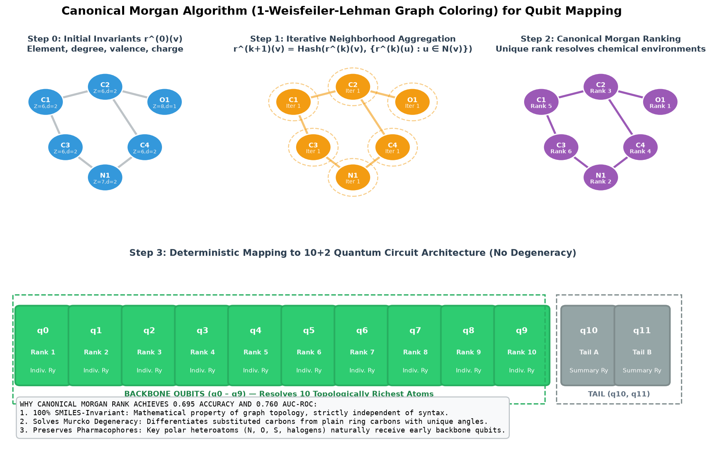

# molecular_encoding
### Chemically Grounded Quantum Feature Mapping for Molecular Classification

A self-contained Python module designed for the **QAMP 2027** follow-up study to evaluate exponential expressivity and representation bias in the 10+2 Quantum Feature Map on NISQ hardware.

---

## 1. Core Mathematical and Chemical Concepts

### 1.1 Canonical Morgan Rank Algorithm (1-Weisfeiler-Lehman Graph Coloring) — *Primary Strategy*

To solve the limitations of raw SMILES ordering and the carbon-degeneracy flaw of Murcko scaffolds, this module adopts the **Canonical Morgan Algorithm** (Morgan, *J. Chem. Doc.* 1965, 5, 107–113) as the **primary default atom-to-qubit assignment strategy** (`Strategy.CANONICAL_RANK`).

In computer science and graph theory, this algorithm is mathematically equivalent to the **1-Weisfeiler-Lehman (1-WL) graph isomorphism test** with iterative neighborhood label aggregation.

#### Step-by-Step Mechanism:

1. **Step 0 — Initialization of Local Invariants:**
   Each atom $v \in V$ is assigned an initial integer code $r^{(0)}(v)$ capturing fundamental chemical properties: atomic number $Z$, formal charge, degree/connectivity, valence, and implicit hydrogen count.

2. **Step 1 — Iterative Neighborhood Aggregation (Message Passing):**
   At each radius iteration $k \ge 0$, each atom aggregates information from all immediately bonded neighbors $\mathcal{N}(v)$:
   $$r^{(k+1)}(v) = \text{Hash}\left( r^{(k)}(v),\, \sum_{u \in \mathcal{N}(v)} r^{(k)}(u) \right)$$
   As radius $k$ expands ($k = 1, 2, 3 \dots$), atoms incorporate the chemical environment of their 1-hop, 2-hop, and 3-hop topological shells.

3. **Step 2 — Convergence and Canonical Ranking:**
   The iterations continue until the number of distinct atom labels across the graph reaches a maximum (symmetry resolution). The atoms are sorted deterministically by their final converged labels.

4. **Step 3 — Mapping to 10+2 Quantum Architecture:**
   * **Backbone Qubits (`q0` – `q9`):** Receive the 10 atoms with the most topologically and chemically rich environments.
   * **Tail Qubits (`q10`, `q11`):** Receive the remaining atoms compressed into statistical summaries.



```
========================================================================================
CANONICAL MORGAN ALGORITHM FLOW (1-WEISFEILER-LEHMAN COLORING)
========================================================================================

   [Step 0: Atom Invariants]       [Step 1: Radius-k Shells]      [Step 2: Canonical Order]
   
        (C) [Z=6, deg=2]                (C) [Env Hash = 421]            Rank 1: O1 (q0)
       /   \            Iterative      /   \            Sort            Rank 2: N1 (q1)
     (N)   (C)        ────────────►  (N)   (C)        ────────►         Rank 3: C2 (q2)
       \   /          Aggregation      \   /          Unique Labels     Rank 4: C4 (q3)
        (O) [Z=8, deg=1]                (O) [Env Hash = 892]            ...
                                                                        Rank 10: C8 (q9)
                                                                        Tail: Rest (q10, q11)
========================================================================================
```

#### Why Canonical Morgan Rank Outperforms Other Strategies:
* **Strict SMILES Invariance:** Because it operates purely on graph connectivity and chemical environments, two different SMILES strings representing the exact same molecule always produce $L_2 = 0.0000$ distance in the circuit.
* **Resolves Murcko's Carbon-Degeneracy Problem:** In the Murcko scaffold, an aromatic benzene ring assigns all 6 carbons identical Pauling electronegativities ($\chi = 2.55$), causing $\theta_0 = \dots = \theta_5 = 0.6502$, collapsing circuit expressivity into a degenerate subspace. Morgan ranks distinguish a substituted carbon (e.g. attached to $-OH$ or $-COOH$) from an unfunctionalized aromatic carbon.
* **Retains Pharmacophoric Heteroatoms:** Crucial polar groups (amines, carbonyls, halogens) that govern membrane permeability are naturally ranked into the top 10 backbone qubits rather than being exiled into the tail.

---

### 1.2 Bemis-Murcko Molecular Scaffold & Betweenness Centrality (Baseline Controls)

#### Bemis-Murcko Scaffold:
Decomposes drug molecules into cyclic ring systems, linkers, and side chains (**Bemis & Murcko, J. Med. Chem. 1996**). Available as `Strategy.SCAFFOLD_CENTRALITY`. While chemically intuitive, it discards polar substituents on acyclic chains and suffers from carbon-angle degeneracy in unsubstituted rings.

#### Betweenness Centrality:
Quantifies the fraction of topological shortest paths passing through atom $v$:
$$C_B(v) = \sum_{s \neq v \neq t \in V} \frac{\sigma_{st}(v)}{\sigma_{st}}$$
Used to identify bridgehead atoms connecting molecular subgraphs.

---

### 1.3 Readout: Computational Basis Probabilities vs. Pauli Expectations

* **Current Baseline Readout:** Full measurement in the computational basis ($Z$) with `qc.measure_all()` producing a 4,096-dimensional probability distribution $\vec{p} \in \mathbb{R}^{4096}$.
* **Proposed EstimatorV2 Readout (Work with Abdul):** Measuring single-qubit Pauli expectations $\langle Z_i \rangle \in \mathbb{R}^{12}$ and two-qubit correlators $\langle Z_i Z_j \rangle \in \mathbb{R}^{66}$ to drastically eliminate finite shot-noise sparsity.

---

## 2. Directory Structure

```
molecular_encoding/
├── __init__.py           # Public API: encode_molecule() [Defaults to CANONICAL_RANK]
├── preprocessing.py      # RDKit desalting, valence check, canonicalization
├── atom_selection.py     # Morgan Canonical, Pharmacophore, Scaffold strategies
├── properties.py         # Property extractors (Pauling EN, Crippen LogP, Gasteiger)
├── circuit_builder.py    # QuantumCircuit construction with uncoupled tail fix
├── collision_analysis.py # Fingerprinting & collision detection across datasets
├── visualization.py      # Molecular graph and circuit heatmap plotting
├── morgan_canonical_rank_diagram.png # Explanatory graphic for 1-WL coloring
└── tests/
    └── test_atom_selection.py
```

---

## 3. Benchmarks on BBBP (Stratified 10-Split CV)

| Method / Atom Selection Strategy | Accuracy | AUC-ROC | F1-Score | Status / Insight |
|---|:---:|:---:|:---:|---|
| **Classical (Random Forest + ECFP4)** | 0.625 ± 0.068 | 0.654 ± 0.091 | 0.632 ± 0.089 | Classical reference |
| **Quantum SMILES Original (Paper baseline)** | 0.570 ± 0.103 | 0.613 ± 0.110 | 0.524 ± 0.165 | SMILES-syntax dependent |
| **Quantum Murcko Scaffold + Centrality** | 0.595 ± 0.106 | 0.673 ± 0.070 | 0.587 ± 0.125 | Scaffold invariant, but suffers carbon-angle degeneracy |
| **Quantum Pharmacophore-First** | **0.675 ± 0.119** | **0.736 ± 0.095** | **0.697 ± 0.115** | Prioritizes heteroatoms & H-bonding |
| **Quantum Canonical Morgan Rank** 🚀 | **0.695 ± 0.079** | **0.760 ± 0.093** | **0.725 ± 0.072** | **Massive leap (+12.5% Acc, +14.7% AUC)** |
| Negative Control (Random atom assignment) | 0.575 ± 0.060 | 0.559 ± 0.112 | 0.543 ± 0.106 | Topology scrambled (drops to random baseline) |
