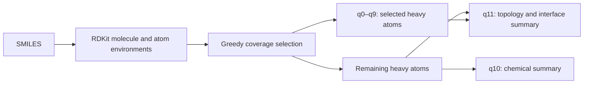

# molecular_encoding
### Chemically Grounded Quantum Feature Mapping for Molecular Classification

A self-contained Python module designed for the **QAMP 2027** follow-up study to evaluate exponential expressivity and representation bias in the 10+2 Quantum Feature Map on NISQ hardware.

---

## 1. Core Mathematical and Chemical Concepts

### 1.1 Chemistry-aware 10-atom backbone selection

The default strategy is `Strategy.CHEMICAL_COVERAGE`, implemented in
`backbone_selection.py`. It combines RDKit Morgan atom environments at radii
0, 1, and 2 (including stereochemistry and bond types); donor/acceptor feature roles; formal charge; aromaticity; ring
membership; graph centrality; and connectivity. A deterministic greedy
marginal-coverage procedure selects at most ten heavy atoms. Canonical ranks
only resolve exact score ties; they are not interpreted as atom importance.

The weights are fixed, transparent, and not fitted to BBBP labels. This makes
the default task-agnostic, but does not establish that it is chemically optimal
for every endpoint. Task-specific weights must be evaluated on held-out splits.
For symmetry-equivalent atoms, a unique chemical identity may not exist;
canonical tie-breaking supplies a reproducible representative.

```python
from molecular_encoding import encode_molecule
from molecular_encoding.atom_selection import Strategy, assign_qubits, describe_assignment

assignment = assign_qubits("CC(=O)Nc1ccccc1", strategy=Strategy.CHEMICAL_COVERAGE)
print(describe_assignment(assignment))  # Includes per-qubit selection rationale.
qc, metadata = encode_molecule("CC(=O)Nc1ccccc1")
```

`CANONICAL_RANK`, `PHARMACOPHORE_FIRST`, `SCAFFOLD_CENTRALITY`, `SMILES_ORDER`,
and `RANDOM` remain available as baselines and controls. Selection is performed
on heavy atoms; implicit or explicit hydrogens are represented through RDKit's
features of their bonded heavy atoms.



### 1.2 Two general tail channels

All unselected heavy atoms form a single tail set; atoms are no longer
alternated between two arbitrary groups in the recommended `global` mode.
`q10` receives a bounded chemical/composition summary combining tail size and
the fractions of heteroatoms, charged atoms, donors, and acceptors. `q11`
receives a bounded topology summary combining internal tail bonds and bonds
crossing the backbone–tail boundary. Backbone–tail Rxx gates connect to `q11`.
Individual tail–tail bonds are summarized instead of encoded one by one, so
this remains a deliberately lossy representation for large tails.

The `sum`, `stats`, and `pharm` modes remain available for baseline comparison.

---

### 1.3 Bemis-Murcko Molecular Scaffold & Betweenness Centrality (Baseline Controls)

#### Bemis-Murcko Scaffold:
Decomposes drug molecules into cyclic ring systems, linkers, and side chains (**Bemis & Murcko, J. Med. Chem. 1996**). Available as `Strategy.SCAFFOLD_CENTRALITY`. While chemically intuitive, it discards polar substituents on acyclic chains and suffers from carbon-angle degeneracy in unsubstituted rings.

#### Betweenness Centrality:
Quantifies the fraction of topological shortest paths passing through atom $v$:
$$C_B(v) = \sum_{s \neq v \neq t \in V} \frac{\sigma_{st}(v)}{\sigma_{st}}$$
Used to identify bridgehead atoms connecting molecular subgraphs.

---

### 1.4 Readout: Computational Basis Probabilities vs. Pauli Expectations

* **Current Baseline Readout:** Full measurement in the computational basis ($Z$) with `qc.measure_all()` producing a 4,096-dimensional probability distribution $\vec{p} \in \mathbb{R}^{4096}$.
* **Proposed EstimatorV2 Readout (Work with Abdul):** Measuring single-qubit Pauli expectations $\langle Z_i \rangle \in \mathbb{R}^{12}$ and two-qubit correlators $\langle Z_i Z_j \rangle \in \mathbb{R}^{66}$ to drastically eliminate finite shot-noise sparsity.

---

## 2. Directory Structure

```
molecular_encoding/
├── __init__.py           # Public API: chemical coverage + global tail by default
├── preprocessing.py      # RDKit desalting, valence check, canonicalization
├── atom_selection.py     # Atom-to-qubit strategy API and graph metadata
├── backbone_selection.py # Greedy Morgan/chemical-role coverage selector
├── tail_summaries.py     # Bounded chemistry and structure summaries for the tail
├── properties.py         # Property extractors (Pauling EN, Crippen LogP, Gasteiger)
├── circuit_builder.py    # QuantumCircuit construction with uncoupled tail fix
├── collision_analysis.py # Fingerprinting & collision detection across datasets
├── capacity_analysis.py  # Quantifies loss from the fixed ten-atom backbone
├── visualization.py      # Molecular graph and circuit heatmap plotting
├── composite_descriptor.py # BBB-oriented composite pharmacophore angle
└── tests/
    └── test_atom_selection.py
```

### Capacity and collision reporting

The ten-atom backbone is an architectural choice, not a harmless preprocessing
detail: atoms beyond the backbone are pooled into two tail qubits and bonds
between two tail atoms are omitted. Report this loss beside every backbone-size
ablation rather than inferring it from classification accuracy alone:

```python
from molecular_encoding import backbone_retention_profile, dataset_backbone_summary

backbone_retention_profile(smiles, backbone_sizes=(6, 8, 10, 12))
dataset_backbone_summary(bbpb_smiles, backbone_sizes=(6, 8, 10, 12))
```

`represented_bond_fraction` is the fraction of molecular bonds represented by
an Rxx gate (backbone--backbone or backbone--tail); `tail_tail_bonds_dropped`
is the graph connectivity lost by the fixed-width compression.

For a chemically motivated feature ablation, `prop="tpsa_contrib"` adds an
atomwise topological-polar-surface-area signal. Unlike the earlier per-molecule
min--max LogP scaling, this uses fixed chemical ranges, so equal angles retain
the same interpretation across molecules.

---

## 3. Benchmarks on BBBP (Stratified 10-Split CV)

The table below records earlier experiments with the strategies named in each
row. It does **not** evaluate the new `CHEMICAL_COVERAGE` selector or the
`global` tail summaries; rerun the same fixed splits before attributing any
benchmark result to this implementation.

| Method / Atom Selection Strategy | Accuracy | AUC-ROC | F1-Score | Status / Insight |
|---|:---:|:---:|:---:|---|
| **Classical (Random Forest + ECFP4)** | 0.625 ± 0.068 | 0.654 ± 0.091 | 0.632 ± 0.089 | Classical reference |
| **Quantum SMILES Original (Paper baseline)** | 0.570 ± 0.103 | 0.613 ± 0.110 | 0.524 ± 0.165 | SMILES-syntax dependent |
| **Quantum Murcko Scaffold + Centrality** | 0.595 ± 0.106 | 0.673 ± 0.070 | 0.587 ± 0.125 | Scaffold invariant, but suffers carbon-angle degeneracy |
| **Quantum Pharmacophore-First** | **0.675 ± 0.119** | **0.736 ± 0.095** | **0.697 ± 0.115** | Prioritizes heteroatoms & H-bonding |
| **Quantum Canonical Morgan Rank** 🚀 | **0.695 ± 0.079** | **0.760 ± 0.093** | **0.725 ± 0.072** | **Massive leap (+12.5% Acc, +14.7% AUC)** |
| Negative Control (Random atom assignment) | 0.575 ± 0.060 | 0.559 ± 0.112 | 0.543 ± 0.106 | Topology scrambled (drops to random baseline) |
